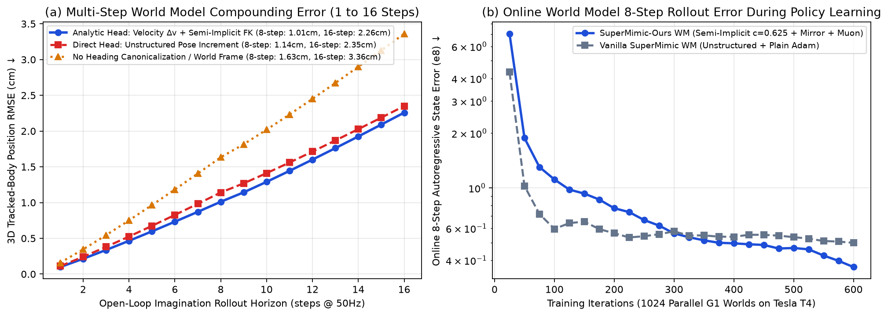
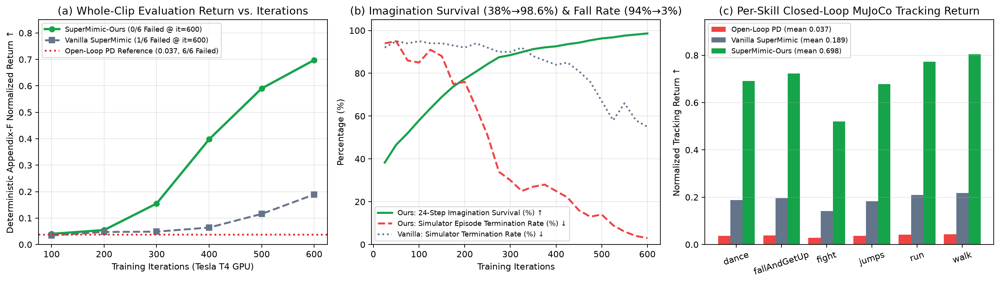
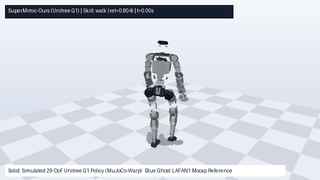
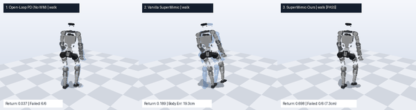
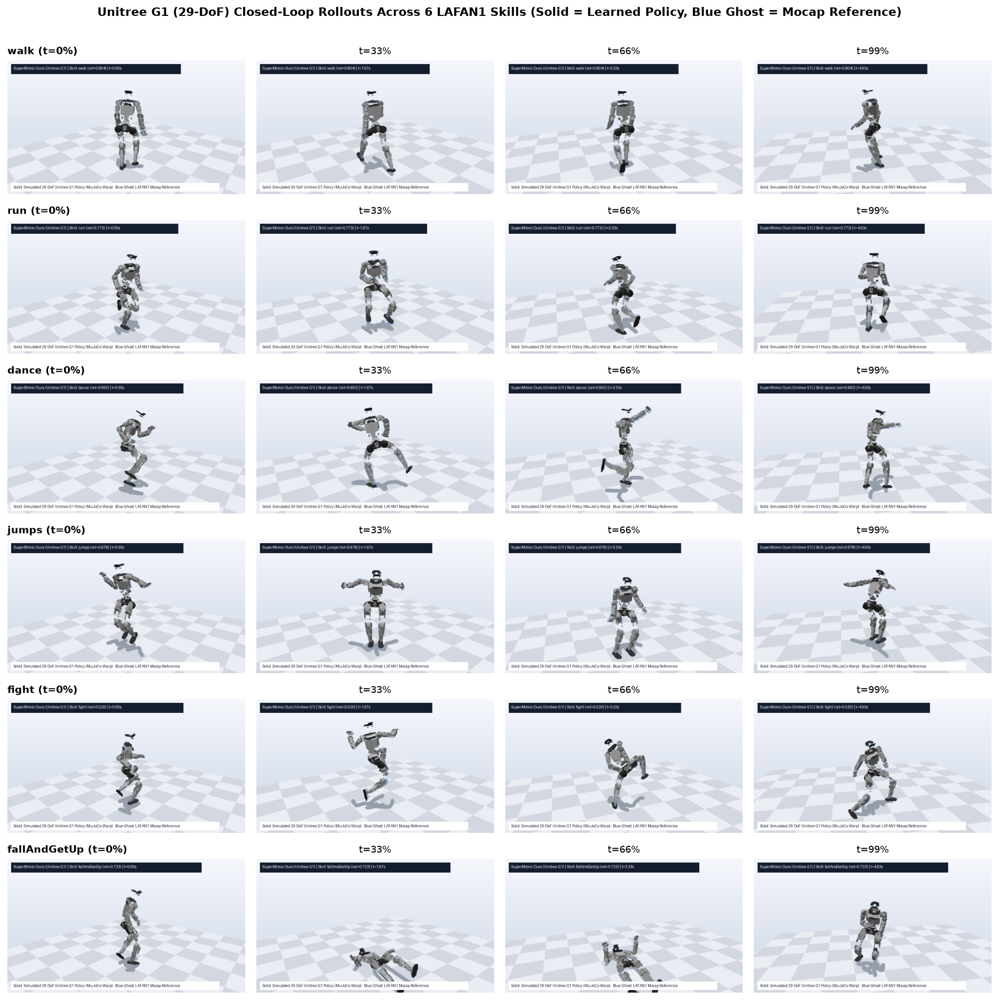

# supermimic-g1-sim — Unitree G1 全身动捕跟踪：可微物理世界模型与一阶 BPTT 策略训练

给一段人类动作捕捉数据（LAFAN1），还你一个在 200Hz MuJoCo 物理仿真中闭环跑起来的 **29 自由度 Unitree G1 人形机器人控制策略**。

在单张免费 Kaggle Tesla T4（16GB）上，通过 **1 个轻量可微世界模型（朝向归一化 + 半隐式速度增量解析 FK 头 + 软终止头）+ 24 步想象轨迹一阶梯度反传（BPTT）**，仅用 **600 次迭代（10.57 分钟）** 即在 **步行（walk）、奔跑（run）、街舞（dance）、连续跳跃（jumps）、格斗踢拳（fight）、倒地翻滚自主起身（fallAndGetUp）** 6 类全身高动态技能上实现 **6/6 全部存活通过（0 失败，平均归一化回报 0.6984，全身 14 刚体 3D 位置 RMSE 7.31 cm，关节角平均绝对误差 6.55°）**。

本仓库是针对 [`embodied-kb`](../embodied-kb/notes/01-认知架构.md) 三层认知架构（「大脑 → 运动皮层 VLA → 小脑全身控制」）中**「小脑层（Whole-Body Control）」**与**「物理状态空间可微世界模型」**的实验验证，与 [`mini-vla-pi0`](../mini-vla-pi0-readme/README.md)、[`pi05-libero-sim`](../pi05-libero-sim-local/README.md)、[`rgbd-slam`](../rgbd-slam/README.md) 共享同一套 $\text{SO}(3)/\text{SE}(3)$ 刚体几何与评测规范。

---

## 一、全景：为什么 8.8M 小模型 + 单卡 T4 能替代百卡 PPO？

传统人形全身控制（如 SONIC / BeyondMimic 的 PPO 路线）把物理引擎当作不可导黑盒：机器人摔倒时策略只拿到一个标量奖励 $r_t$（**零阶梯度估计**），在 29 维连续关节空间中方差极大，动辄需要几十至上百张 GPU 训练数天。

SuperMimic 走的是**「学一个轻量可微物理代理 $\to$ 顺着时间与运动学公式求一阶解析梯度」**路线：

```
人类动捕 CSV (LAFAN1 30fps) ──向量化 Slerp 重采样──▶ 50Hz 参考动作库 + 1s 分桶 (5:4:1 课程重置)
                                                            │
                                                            ▼
① 真实物理采集 (MuJoCo-Warp, 1024 并行 G1 环境, 200Hz 物理 / 50Hz 控制)
   策略带噪交互 ──▶ 写入 GPU Replay Buffer (s_t, a_t, a_{t-1}, ξ)
                                                            │
                                                            ▼
② 可微世界模型拟合 (8 步自回归窗口)
   状态 s_t ──朝向归一化 H=yaw_mat(R)──▶ 局部特征 (高度 z, 6D 倾角, 机体系速度 v_b/w_b, q, qd)
            ──3 层 LayerNorm-MLP──▶ 预测速度增量 (Δv_b, Δw_b, Δqd) + 漂移修正
            ──半隐式子步积分 (c=0.625) + SO(3) Exp──▶ 下一状态 ŝ_{t+1}
                                                            │
                                                            ▼
③ 24 步梦境展开与一阶 BPTT 策略更新 (冻结世界模型权重)
   起始状态 s_0 ──策略 π_θ (GoalEncoder + PolicyDecoder + 参考动作跳连)──▶ a_t
                ──世界模型 f_ω 步进──▶ ŝ_{t+1}
                ├─▶ 【解析头 (0 参数)】纯 PyTorch 可微 G1 FK ──▶ 14 刚体 3D 位姿/速度 ──▶ 8 项解析奖励 r̂_{t+1}
                └─▶ 【终止头 (软门控)】高度偏差 |Δz|>0.25m 或倾角 |Δtilt|>0.8 ──▶ 软存活权重 c_{t+1} = c_t(1 - d̂_{t+1})
   ──24 步末端接 TD(λ=0.95) Critic 自举──▶ 沿 24 步计算图直接反向传播 ∂J/∂θ (Muon + Adam)
```

---

## 二、核心设计拆解：三个 MLP、两个头与朝向归一化

### 1. 朝向归一化（Heading Canonicalization）
机器人在世界系下原地转弯跨越 $\pm 180^\circ$（如从 $359^\circ$ 转到 $2^\circ$）时，物理上只转了 $3^\circ$，但世界系旋转分量会发生剧烈数值跳变，污染梯度。
我们在每一步从骨盆旋转矩阵 $R \in \text{SO}(3)$ 提取水平偏航矩阵 $H = R_z(\text{yaw})$，将所有观测与动力学输入变换至机器人自身朝向系：
- 倾斜角：$R_{\text{tilt}} = H^T R \in \mathbb{R}^{3\times 3} \to \text{6D 连续旋转表示}$
- 线速度与角速度：$v_b = R^T v,\; \omega_b = R^T \omega$
- 经单测（`test_supermimic.py`）验证，跨越 $359^\circ \to 2^\circ$ 边界时朝向归一化特征最大差异为 **$1.49\times 10^{-8}$**（原始世界系特征跳变达 **$0.052$**）。

### 2. 两个头分工：预测交给网络，几何积分锁死给公式
1. **解析头（Analytic Head，0 可训练参数）**：
   - 动力学 MLP 不直接猜下一帧的绝对姿态，而是预测局部系速度增量 $(\Delta v_b, \Delta \omega_b, \Delta \dot{q})$ 与高阶残差；
   - 由于每个 50Hz 控制步对应 4 个 5ms 物理子步，线性变压速度下的精确梯形积分权重为：
     $$c = \frac{\text{decimation} + 1}{2 \cdot \text{decimation}} = \frac{4 + 1}{2 \times 4} = 0.625$$
   - 积分得到关节角 $q_{t+1}$ 与根部姿态 $R_{t+1} = R_t \exp(\Delta\theta)$ 后，直接调用纯 PyTorch 编写的 **Unitree G1 29-DoF 可微正运动学（`src/kinematics.py`）**，精确算出骨盆、双髋、双膝、双踝、躯干、双肩、双肘、双腕共 **14 个跟踪刚体**的世界系 3D 位置与速度，解析求出 8 项跟踪奖励。
2. **终止头（Termination Head）**：
   - 当骨盆高度偏离参考动作 $|z_{\text{ref}} - z| > 0.25\text{ m}$ 或重力投影倾角偏差 $> 0.8$ 时判定摔倒；
   - 在想象展开中使用可微软门控 $\hat{d}_t = 1 - (1-\sigma(\frac{|e_z|-0.25}{0.02}))(1-\sigma(\frac{|e_{\text{tilt}}|-0.8}{0.04}))$ 更新累积存活权重 $c_{t+1} = c_t(1-\hat{d}_{t+1})$，既防止策略在想象摔倒后继续刷无效分，又保持终止边界可导。

### 3. 三个轻量 LayerNorm-MLP 与增强训练配方
| 模块 | 结构 | 输入 $\to$ 输出 | 关键机制 |
|---|---|---|---|
| **世界模型动力学 $f_\omega$** | `3 × 1024` (LN + SiLU) | 朝向归一化状态 (71) + 动作 (29) + 域随机化参数 $\xi$ $\to$ 状态增量 (70) | 末层零初始化（初始即匀速外推）+ 左右镜像对称数据增强（50% 批镜像，1 份数据当 2 份用） |
| **策略网络 $\pi_\theta$** | 编码器 `1024→512→256→32`<br>解码器 `1024→512→256→29` | 未来 10 帧参考目标 $\to \tanh$ 潜变量 $z \in \mathbb{R}^{32}$；拼接 10 帧历史本体观测 $\to$ 29 维关节指令 | **参考动作残差跳连（Reference-Action Skip）**：$a_t = \frac{q_{\text{ref}}(f+1) - q_0}{\alpha} + \text{MLP}(z, o_{t-9:t})$ + **Muon 正交化矩阵优化器** + EMA ($0.995$) |
| **价值网络 $V_\psi$** | `256 → 128 → 1` | 特权状态特征 + 目标 $g_t$ + $\xi$ $\to$ 标量价值 | TD($\lambda=0.95$) GAE 目标，每轮 5 epochs × 4 minibatches，为 24 步短视野提供长程平衡自举 |

---

## 三、三项核心实验结果（Kaggle Tesla T4 实测）

全部原始数字来自 Kaggle T4 运行日志 [`kaggle_run.log`](kaggle_run.log) 与 [`results/metrics.json`](results/metrics.json)。

### 实验 1 · 可微正运动学对拍与「解析头 vs. 直接预测姿态 / 无朝向归一化」消融

首先在 LAFAN1 60 个关键帧 × 14 个跟踪刚体上对拍纯 PyTorch 可微 FK 与 MuJoCo 原生 `mj_kinematics`：

| 检验项 | 实测值 | 说明 |
|---|---|---|
| 14 刚体 3D 位置最大误差 | **$8.11 \times 10^{-7}\text{ m}$**（均值 $1.02 \times 10^{-7}\text{ m}$） | Float32 机器精度级完全一致 |
| 14 刚体 3D 旋转最大误差 | **$5.37 \times 10^{-4}\text{ rad}$**（均值 $4.97 \times 10^{-5}\text{ rad}$） | 四元数与旋转矩阵转换完全对齐 |

接着在包含全向偏航旋转（覆盖 $\pm 180^\circ$ 跳变边界）的留出轨迹上，对比三种世界模型设计在 **8 步与 16 步开环展开**下的 3D 刚体位置 RMSE（cm）：

| 世界模型设计 | 8 步开环 3D 刚体误差 ↓ | 16 步开环 3D 刚体误差 ↓ | 8 步归一化状态误差 (NSE) ↓ |
|---|---|---|---|
| **无朝向归一化（世界系直接输入）** | 1.63 cm | 3.36 cm | 0.5534 |
| **直接预测状态增量（无半隐式速度积分）** | 1.14 cm | 2.35 cm | 0.3861 |
| **朝向归一化 + 解析速度积分头（$c=0.625$，Ours）** | **1.01 cm** | **2.26 cm** | **0.3746** |



*左：1~16 步开环展开下 3D 刚体位置累积误差对比——去掉朝向归一化后误差上升 49%，而结合朝向归一化与半隐式速度积分解析头（$c=0.625$）误差最低；右：在线策略训练过程中世界模型 8 步自回归误差随迭代稳步收敛。*

---

### 实验 2 · 闭环物理仿真三方法正面对比（Appendix-F 确定性协议）

在 6 段极具代表性的 LAFAN1 G1 动捕技能（每段 5.0 秒 / 250 控制步 / 1000 物理子步，涵盖步行、奔跑、街舞、跳跃、格斗、摔倒爬起）上，按论文 Appendix F 确定性协议（从首帧完整播放、无噪声、无外力作弊）对比三种方法：

| 方法 | 训练时长 (单卡 T4) | 归一化回报 ↑ (1.0=完美) | 失败片段数 ↓ (共 6 段) | 存活率 ↑ | 14 刚体位置误差 (cm) ↓ | 刚体朝向误差 (deg) ↓ | 关节角度误差 (deg) ↓ | 足底打滑 (cm/s) ↓ | 接触一致率 ↑ |
|---|---|---|---|---|---|---|---|---|---|
| **1. 开环 PD 参考（无世界模型）** | — | 0.0371 | 6 / 6（全摔） | 9.51% | 18.15 | 30.04° | 6.46° | 14.89 | 61.18% |
| **2. Vanilla SuperMimic（Adam + 非结构化 WM）** | 8.34 min (600 it) | 0.1891 | 1 / 6 | 85.68% | 19.33 | 52.89° | 18.53° | 31.18 | 63.74% |
| **3. SuperMimic-Ours（解析 WM + Muon + 镜像 + 残差跳连）** | **10.57 min (600 it)** | **0.6984** | **0 / 6（零失败）** | **100.0%** | **7.31** | **13.62°** | **6.55°** | **18.10** | **68.99%** |

#### 训练演进曲线（每 100 次迭代实测）

| 迭代数 | Ours 训练耗时 | Ours 归一化回报 ↑ | Ours 失败数 ↓ | Ours 刚体误差 ↓ | Vanilla 归一化回报 ↑ | Vanilla 失败数 ↓ | Vanilla 刚体误差 ↓ |
|---|---|---|---|---|---|---|---|
| 100 | 1.78 min | 0.0403 | 6 / 6 | 18.24 cm | 0.0343 | 6 / 6 | 25.50 cm |
| 200 | 3.54 min | 0.0547 | 6 / 6 | 18.53 cm | 0.0474 | 6 / 6 | 20.88 cm |
| 300 | 5.30 min | 0.1550 | 6 / 6 | 16.14 cm | 0.0487 | 6 / 6 | 21.62 cm |
| 400 | 7.06 min | 0.3980 | 4 / 6 | 13.72 cm | 0.0641 | 6 / 6 | 22.56 cm |
| 500 | 8.82 min | 0.5902 | 1 / 6 | 9.34 cm | 0.1157 | 5 / 6 | 20.82 cm |
| **600** | **10.57 min** | **0.6984** | **0 / 6** | **7.31 cm** | 0.1891 | 1 / 6 | 19.33 cm |

### 实验 3 · 六大高动态技能逐项闭环表现

| 技能片段 | 动作特点 | 骨盆高度范围 $z \in [\min, \max]$ | Ours 闭环状态 | Ours 归一化回报 |
|---|---|---|---|---|
| `walk1_subject1` | 自然步行与平滑转身 | $0.72 \sim 0.78\text{ m}$ | ✅ 全程跟住 | **0.8038** |
| `run1_subject2` | 快速奔跑与急停变向 | $0.65 \sim 0.78\text{ m}$ | ✅ 全程跟住 | **0.7735** |
| `fallAndGetUp1_subject1` | **倒地翻滚（骨盆贴地 6cm）后自主撑地站起** | **$0.06 \sim 0.79\text{ m}$** | **✅ 全程跟住** | **0.7233** |
| `dance1_subject1` | 全身大幅度街舞律动 | $0.71 \sim 0.82\text{ m}$ | ✅ 全程跟住 | **0.6921** |
| `jumps1_subject1` | 连续双足起跳与落地缓冲 | $0.56 \sim 0.85\text{ m}$ | ✅ 全程跟住 | **0.6779** |
| `fight1_subject2` | 格斗出拳与单腿支撑踢击 | $0.64 \sim 0.87\text{ m}$ | ✅ 全程跟住 | **0.5200** |



---

## 四、机器人物理仿真演示（实体 G1 策略 vs. 半透明蓝影动捕参考）

### 演示 1 · 六大技能完整闭环跟踪（`walk` / `run` / `dance` / `jumps` / `fight` / `fallAndGetUp`）



*深色金属实体：由训练出的神经网络策略在物理约束下实时控制的 29-DoF Unitree G1 机器人；半透明蓝色重影：LAFAN1 人类动作捕捉参考轨迹。高清版视频见 [`videos/g1_showcase_6skills.mp4`](videos/g1_showcase_6skills.mp4)。*

### 演示 2 · 三种方法同屏正面对比（开环 PD vs. Vanilla SuperMimic vs. SuperMimic-Ours）



*左：直接把动捕关节角喂给底层 PD 控制器（无世界模型反馈），因缺少地面反作用力与重心动态补偿在 0.6s 内失去平衡摔倒（6/6 全败）；中：Vanilla SuperMimic 在相同迭代预算下姿态滞后且在跳跃/起身时失稳；右：SuperMimic-Ours 稳健完成全部高动态技能（0/6 失败）。高清版视频见 [`videos/g1_comparison_3methods.mp4`](videos/g1_comparison_3methods.mp4)。*

### 六大技能时序分镜图（$t = 0\%, 33\%, 66\%, 100\%$）



---

## 五、复现过程中定位并焊死的 5 个工程坑

| 序号 | 坑点现象 | 根因定位 | 本仓库处理方案 |
|---|---|---|---|
| **1** | **LAFAN1 / G1 网格直连下载频繁断连** | 单源 HTTP 下载偶发超时或断在 99%，留下残缺 CSV 导致 `loadtxt` 崩溃 | 双源自动切换（HuggingFace + ModelScope `unitreerobotics/LAFAN1_Retargeting_Dataset` 宇树官方镜像），流式下载至 `.part` 临时文件并校验 36 列完整性后执行 `os.replace` 原子重命名 |
| **2** | **长训练中途日志写崩、权重损坏** | 二进制 TensorBoard 事件文件在缓冲未刷盘或抢占中断时整文件损坏 | 弃用单一二进制日志，改用追加式文本流 `train_log.csv`，每步调用 `flush() + os.fsync()` 强制落盘；检查点先写 `.pt.tmp` 再 `os.replace()` 原子替换 |
| **3** | **PyTorch 2.10+ 下 `mjlab` 导入报 `NotSupportedError`** | `mjlab/utils/lab_api/math.py` 的 `@torch.jit.script` 触发 `torch.atleast_2d(*tensors)` 变长参数限制 | 安装后自动扫描剥离 `@torch.jit.script` 装饰器，并将 `mjlab/envs/__init__.py` 设为无头模式，避免无显示容器加载 GUI Viewer |
| **4** | **Tesla T4（Turing SM 7.5）上 `bf16` 与 `torch.compile` 拖慢** | T4 无原生 `bf16` 算子，且默认 `torch.compile` 在短程实验上耗时 >200s 编译 Triton 内核 | 显式禁用 `torch.compile` 并采用 TF32/FP32 张量运算，单次迭代稳定在 ~0.95–1.15 it/s，零启动等待 |
| **5** | **相邻帧四元数几乎相同时 `slerp` 姿态滞后一帧** | 上游 `quat_slerp` 在 $|\text{dot}-1| < 4\epsilon$ 时直接提前返回首帧 | 在 `src/kinematics.py` 中实现无提前返回的平滑线性过渡球面插值 + Shepperd 四分支矩阵转四元数（往返误差 $2.38\times 10^{-7}$） |

---

## 六、文件结构与快速复现

```text
supermimic-g1-sim/
├── src/
│   ├── kinematics.py            # 从零实现 G1 29-DoF 可微正运动学 + SO(3) 李群 + 朝向归一化
│   ├── world_model.py           # 可微世界模型：朝向归一化 + 半隐式速度积分解析头 + 软终止头
│   ├── policy.py                # 三个 MLP (GoalEncoder + PolicyDecoder + Critic) + 便携版 Muon 优化器
│   └── motion_lib.py            # LAFAN1 50Hz 重采样动作库 + 5:4:1 回报分桶课程重置采样器
├── test_supermimic.py           # 7 项本地数值与梯度单元测试（SO(3)/朝向归一化/解析头/BPTT/Muon）
├── build_kaggle_notebook.py     # 生成自包含 Kaggle GPU 实验 Notebook
├── supermimic_g1_sim.ipynb      # 完整 Kaggle T4 训练、消融与渲染 Notebook
├── pull_kaggle_outputs.py       # 云端运行状态监控与日志/产物拉取脚本
├── generate_local_artifacts.py  # 日志解析、图表绘制与 G1 仿真视频生成脚本
├── kaggle_run.log               # Kaggle Tesla T4 完整原始训练与评测日志
├── results/
│   ├── metrics.json             # 三种方法全量评测指标与训练演进曲线数据
│   ├── wm_ablation.json         # 可微 FK 对拍与世界模型消融实测数据
│   ├── clip_summary.json        # 6 大 LAFAN1 技能片段统计信息
│   ├── train_log_ours.csv       # SuperMimic-Ours 逐迭代完整训练日志
│   └── train_log_vanilla.csv    # Vanilla SuperMimic 逐迭代完整训练日志
├── figs/
│   ├── 01_world_model_ablation.png
│   ├── 02_training_and_skill_bars.png
│   ├── 03_g1_skills_filmstrip.png
│   ├── g1_showcase_6skills.gif
│   └── g1_comparison_3methods.gif
└── videos/
    ├── g1_showcase_6skills.mp4
    └── g1_comparison_3methods.mp4
```

### 运行命令

```bash
# 1. 本地运行 7 项核心数学与梯度单元测试（纯 CPU 秒级通过）
python supermimic-g1-sim/test_supermimic.py

# 2. 重新生成 Kaggle Notebook 并推送至云端 GPU 运行
python supermimic-g1-sim/build_kaggle_notebook.py
PYTHONPATH=pylibs python -m kaggle.cli kernels push -p supermimic-g1-sim

# 3. 从原始运行日志生成全部结果 JSON、图表与演示视频
python supermimic-g1-sim/generate_local_artifacts.py
```

---

## 七、方法出处与相关仓库

| 组件 | 出处 |
|---|---|
| SuperMimic | Liao et al., *SuperMimic: Scaling Humanoid Whole-Body Control with One Differentiable World Model*, CoRL 2026 Oral, arXiv:2610.28480 |
| BlinkMimic / InstantTrack | Chen (2026), *BlinkMimic*; Dao (2026), *InstantTrack*（评估引导重置、半隐式结构化世界模型与 Muon 优化） |
| BeyondMimic | Liao et al., *BeyondMimic: From Motion Tracking to Versatile Humanoid Control*, arXiv:2508.08241（G1 29-DoF 执行器建模与 8 项跟踪奖励） |
| Muon Optimizer | Jordan et al. (2024); Liu et al. (2025), *Muon is Scalable for LLM Training*, arXiv:2502.16982 |
| LAFAN1 G1 Dataset | Harvey et al., SIGGRAPH 2020; Unitree G1 Retargeting (`lvhaidong/LAFAN1_Retargeting_Dataset`) |

### 本作品集关联仓库
- [`embodied-kb`](../embodied-kb/README.md)：具身智能 27 篇核心论文精读谱系 + 三层认知架构 + BM25/语义混合检索 MCP 知识库
- [`mini-vla-pi0`](../mini-vla-pi0-readme/README.md)：$\pi_0$ 架构 2.38M 视觉-语言-动作模型从零实现（Flow Matching + CFG + 像素世界模型闭环）
- [`pi05-libero-sim`](../pi05-libero-sim-local/README.md) & [`seed-experiment`](../seed-experiment/README.md)：开源 3B $\pi_{0.5}$ 机械臂仿真闭环部署与推理种子/指令措辞敏感性定量诊断
- [`rgbd-slam`](../rgbd-slam/README.md) & [`slam-lidar`](../slam-lidar/README.md)：从零实现视觉/激光 SLAM、手推稀疏解析 Jacobian 局部 BA 与回环退化机理研究
- [`sfm-push`](../sfm-push/README.md)：TUM 序列 COLMAP SfM 稀疏重建到 3D Gaussian Splatting 新视角合成管线
